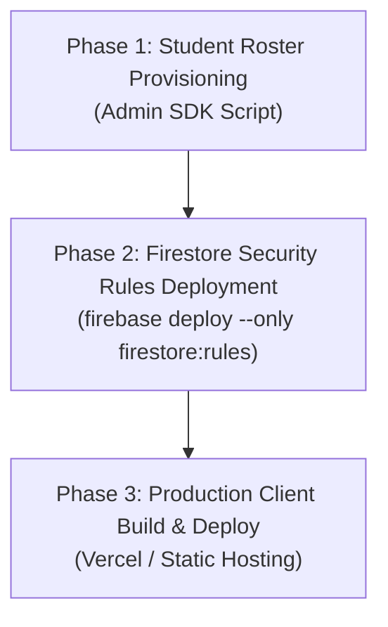

# Production Deployment Order & Migration Strategy

This runbook specifies the strict deployment sequence, migration steps, and rollback procedures for the MYTH DSA platform hardening release.

### Environment Variable Configuration (Staging vs Production)
To point the client at a staging or production Firebase instance, create a `.env.local` or `.env.staging` file (kept out of git):
```env
VITE_FIREBASE_API_KEY=AIzaSy...
VITE_FIREBASE_AUTH_DOMAIN=your-staging-project.firebaseapp.com
VITE_FIREBASE_PROJECT_ID=YOUR_STAGING_PROJECT_ID
VITE_FIREBASE_STORAGE_BUCKET=your-staging-project.appspot.com
VITE_FIREBASE_MESSAGING_SENDER_ID=1234567890
VITE_FIREBASE_APP_ID=1:1234567890:web:abcdef
```
Vite automatically hydrates `import.meta.env.VITE_FIREBASE_*` during build time (`npm run build -- --mode staging`).

---

## 1. Strict Deployment Sequence

To prevent client downtime or permission denials, deployments must proceed in this exact 3-phase order:



### Phase 1: Roster & Claims Provisioning (Admin SDK)
*Run this BEFORE deploying rules. If rules are deployed before roster claims exist, legitimate students will be blocked.*
1. Prepare verified university roster `roster.csv` (formatted with `roll`, `email`, `name`).
2. Run dry-run verification:
   ```bash
   node scripts/migrate-roster.js
   ```
3. Execute live provisioning against staging/production:
   ```bash
   $env:DRY_RUN="false"
   $env:FIREBASE_SERVICE_ACCOUNT_PATH="./service-account.json"
   node scripts/migrate-roster.js
   ```
4. Verify that documents exist in `myth_rolls/{roll}` and `myth_roster/{email}`.

### Phase 2: Security Rules Deployment
1. Verify rule tests pass in local emulator:
   ```bash
   npm test
   ```
2. Deploy to staging project first:
   ```bash
   firebase use staging
   firebase deploy --only firestore:rules
   ```
3. After verification on staging, deploy to production:
   ```bash
   firebase use default
   firebase deploy --only firestore:rules
   ```

### Phase 2.5: Legacy Leaderboard Cleanup
*Run this after rules are deployed and before publishing the client, to ensure legacy roll-keyed records are purged:*
1. Run dry-run cleanup:
   ```bash
   node scripts/cleanup-legacy-leaderboard.js
   ```
2. Execute live purge:
   ```bash
   $env:DRY_RUN="false"
   $env:FIREBASE_SERVICE_ACCOUNT_PATH="./service-account.json"
   node scripts/cleanup-legacy-leaderboard.js
   ```

### Phase 3: Client Deployment
1. Verify clean zero-error production build:
   ```bash
   npm run build
   ```
2. Deploy the `dist/` directory to Vercel/hosting:
   ```bash
   vercel --prod
   ```

---

## 2. Plan for Existing Docs (Without `uid` & Roll-Keyed Leaderboard)

### A. Old Roll-Keyed Leaderboard Records
* **Current State**: Prior versions stored records directly at `myth_leaderboard/{roll}` with real roll numbers.
* **Hardened State**: The new architecture keys `myth_leaderboard/{uid}` by the user's Firebase Auth UID with zero roll numbers and zero emails.
* **Migration Plan**:
  1. Once students log in with Google, client logic writes their anonymized record to `myth_leaderboard/{uid}`.
  2. A cleanup query (or Admin SDK script `scripts/cleanup-legacy-leaderboard.js`) reads all documents in `myth_leaderboard` matching regex `^[0-9]{13}$` and deletes them once their corresponding UID records are established.

### B. Old Profile Docs Without `uid`
* Once rules are deployed, `myth_users/{roll}` updates require `request.resource.data.uid == request.auth.uid`.
* Because `saveUserProfile()` in `cloud-db.js` now writes `{ ...profile, uid: this.auth.currentUser.uid }` on every login, existing documents are automatically backfilled with `uid` on the student's first Google sign-in.

---

## 3. Rollback Procedures

If issues arise post-deployment:

### Scenario A: Legitimate Student Denied Access ("Not in Roster")
1. Check student's Google email against `myth_roster/{email}` in Firebase console.
2. If email typo exists, update email using the admin script:
   ```bash
   $env:DRY_RUN="false"; $env:FIREBASE_SERVICE_ACCOUNT_PATH="./service-account.json"; node scripts/update-student-email.js --roll <ROLL> --new-email <VERIFIED_EMAIL>
   ```

### Scenario B: Rules Issue Causing Widespread Read/Write Failure
1. Roll back rules immediately to previous known stable tag:
   ```bash
   git checkout HEAD~1 firestore.rules
   firebase deploy --only firestore:rules
   ```

### Scenario C: Client Regression
1. Roll back deployment via Vercel dashboard instant rollback button, or redeploy previous commit.
